# Proof

**Claude can't call it done until the checks have run.**



The most common way an AI coding session goes wrong is a confident *"All done — tests pass!"* when the tests never ran after the last edit. Proof closes that gap. If Claude changed code and tries to finish without a passing test, lint, or typecheck since, Proof stops it once and says exactly what to run:

```
Proof: 2 files changed since the last passing check — src/auth.ts, src/session.ts.
Before finishing, run `pnpm test` · `pnpm run typecheck`. If they genuinely can't
run here, stop and tell the user plainly that the change is unverified and why.
```

Claude then runs the check, fixes what it finds, or tells you honestly that the change is unverified. Every one of those outcomes beats a false "done."

## Install

```
/plugin marketplace add giveitlegs/proof
/plugin install proof@proof
```

There's nothing to configure. Proof reads your `package.json`, `Cargo.toml`, `go.mod`, `pyproject.toml`, `Makefile` and similar files to learn what "the checks" are.

## How it behaves

| Situation | Proof |
|---|---|
| Read-only session, questions, exploring | Silent |
| Only docs, images, or `.claude/` changed | Silent |
| Code changed, then a check passed | Silent |
| Code changed, no check since | Stops Claude once and names the files and the command |
| Code changed and the last check failed | Stops Claude once: "`pytest` failed after your latest change" |
| Claude stops again without changing anything | Lets it go. It was told, and was told to tell you |
| The project has no checks Proof can find | Silent, unless you add some (see below) |
| Node isn't installed | Silent. Proof never breaks a session |

Proof speaks **once per state**, so it can't loop and it doesn't nag.

### What counts as a check

Test runners, linters, typecheckers and builds across common ecosystems, including:
- **JavaScript:** `npm`/`pnpm`/`yarn`/`bun` `test`/`lint`/`typecheck`/`build`, `tsc`, `vitest`, `jest`, `eslint`, `biome`, `playwright test`, `node --test`, `deno test`.
- **Python:** `pytest`, `mypy`, `ruff`, `tox`.
- **Rust and Go:** `cargo test`/`check`/`clippy`, `go test`/`vet`.
- **Make-style runners:** `make`/`just` `test`/`check`.
- **JVM, .NET and Ruby:** `mvn`, `gradle`, `dotnet test`, `rspec`.
- **Others:** `mix test`, `swift test`, plus scripts named `test.sh`, `check.sh` and similar.

The usual wrappers are understood too: `cd x && …`, `CI=1 …`, `uv run`, `npx`, `bundle exec`, `timeout`.

A check that exits non-zero is a failure. A check piped through `| tail` or `|| true` exits 0 even when it fails, so Proof reads its output for failure summaries (`3 failed`, `FAILED`, `error TS2322`, `not ok`…).

## `/proof`

```
Proof · my-app

◐ Unverified: 1 file changed since the last passing check.
  src/math.js
  Last pass: `npm test` 4m ago

Checks: `npm test` · `npm run lint`
```

- `/proof` shows the current state.
- `/proof off` pauses Proof for this project.
- `/proof on` resumes it.

## Configure (optional)

Add `.claude/proof.json` to your repo:

```json
{
  "checks": ["./bin/smoke", "make verify"],
  "ignore": ["content/**", "**/*.generated.ts"]
}
```

- **`checks`**: extra commands that count as verification. They're also suggested first.
- **`ignore`**: globs whose edits never require verification.
- **`enabled: false`**: turns Proof off for everyone on the repo.

Set `PROOF_DISABLED=1` to turn it off for one shell.

## What Proof runs, stores, and sends

- **Runs:** one local Node script, `scripts/proof.mjs`, from four hooks:
  - `PostToolUse` on file edits and on Bash;
  - `PostToolUseFailure` on Bash;
  - `Stop`.

  The `/proof` command runs the same script. Proof never executes your checks itself. It only watches the commands Claude runs.
- **Reads:**
  - the hook payloads Claude Code sends;
  - your project's manifest files (`package.json`, `Cargo.toml`, `go.mod`, `pyproject.toml`, `Makefile`…), to suggest checks;
  - `.claude/proof.json`, if present.
- **Stores:** a small per-session JSON file in the plugin's data directory (`${CLAUDE_PLUGIN_DATA}`), holding:
  - edited file paths;
  - the last check command and whether it passed.

  Files older than 14 days are pruned. Uninstalling removes the directory.
- **Sends:** nothing. Proof makes no network calls, collects no telemetry, and has no dependencies.

## Develop

```
node --test test/proof.test.mjs            # unit + end-to-end hook tests
claude plugin validate --strict .
claude --plugin-dir .                      # try it live
```

Requires Node 18 or newer.

MIT licensed.
